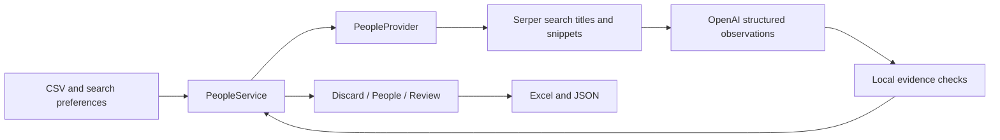

# Architecture and admission rules

The application has two workflows: the existing company-facts enrichment and the People feature. UI and CLI both call the People service; neither implements its own admission policy.

## Responsibilities

| Module | Responsibility |
| --- | --- |
| `people/models.py`, `providers.py` | Data records and injectable discovery contract; mock provider; failure types. |
| `people/identity.py` | Canonical profile URLs, whole-phrase matching, company names/domain/aliases. No service or provider dependency. |
| `people/search.py`, `live.py` | Bounded search requests, query planning, evidence merging, fair candidate selection, provider orchestration. |
| `people/classification.py`, `llm_retry.py` | Structured model request/response contract, safe API errors, bounded transient retries, attempt/token accounting. |
| `people/evidence.py` | Deterministic conversion of a saved observation and its source into a Candidate; title/name grounding and employment diagnostics. No network calls. |
| `people/service.py` | Input normalization; ordered company runs; one admission/deduplication policy; progress, partial failures, result metadata. |
| `people/job_runner.py` | Background thread, submission snapshot detached from caller inputs, pause/stop events, progress snapshots, backups. |
| `people/ui.py`, `cli.py`, `people/excel_export.py` | Configuration and presentation; shared service calls; safe workbook/JSON output. |
| `people/evaluation.py` | Offline comparison against explicit reference profiles; no independent factual verification. |

Optional `company_pages.py` / `public_pages.py` provide narrowly supported founder links from company-published pages. This source is off in the 55-company run. The company-mention gate applies to all real candidates, including this source. The normal People workflow does not fetch LinkedIn profiles.

The existing `service.canonical_linkedin_url`, `service.has_company_mention`, and `OpenAIRoleClassifier._candidate` entry points forward to the shared implementations for existing callers and saved-run scripts. They are intentional compatibility exports, not duplicate implementations.

## Actual flow and limits

1. Normalize company inputs, domains, aliases, and list tags. Merge matching name/domain identities and retain input order.
2. Plan `site:linkedin.com/in/ (name OR domain OR aliases)` queries for the selected role groups. Search criteria affect discovery; a returned search result is not employment evidence by itself.
3. Execute queries within the cap, accept personal LinkedIn URLs, merge repeated snippets, then select profiles round-robin across successful query groups within the candidate cap.
4. The model copies names/titles independently of employer judgment, then suggests employment and grouping labels. Source IDs bind each observation to a returned URL; the model does not generate profile URLs. An uncertain company association must not erase an available copied title.
5. Local evidence checks validate literal fields before employment diagnostics. A narrowly scoped recovery may copy an unambiguous role from the same person's named search headline. Unsupported extractions cannot be presented as factual titles; ambiguous evidence and explicit conflicts retain Review reasons. The service applies the ordered rules below and exports results.

The measured full pass used 10 queries and at most 40 profiles per company, founders/C-level plus AI, Product, Infrastructure, and Engineering; EVP/SVP/VP/Head/Director and Distinguished/Fellow/Principal/Staff/Senior. Product includes Product Marketing and Product Partnerships. These are search preferences, not a complete-roster guarantee or the default four-query budget.

## Ordered admission rules

These rules describe the implementation, not a claim that every rule judgment is correct.

An active department search requires at least one department and at least one leadership or IC level. Employment status `uncertain` with an already verified legacy Candidate is accepted as `supported`; the inconsistent-flag rejection below specifically covers unverified `current` claims.

| Order | Check | Outcome |
| --- | --- | --- |
| 1 | Source **Evidence Text**, excluding occurrences of the person's complete supplied name, contains none of the target company name, domain, or configured aliases. Matching ignores case/repeated whitespace and requires whole phrases. Query text, target columns, generated notes, and source URL alone do not count. | Discard from People and Review; report count in company Notes. |
| 2 | No department search is active: apply the selected founder/C-level categories. In an active department search, department/seniority agreement is advisory. | Exclude known unselected categories in founder/C-level-only mode; unknown selected-category support requires Review. |
| 3 | Missing/unsupported name, invalid personal profile/evidence URL, unresolved unsupported title extraction, or conflicting names for the same retained profile. | `needs_review`. Missing title alone is allowed only in an active department search; founder/C-level-only selection still requires category/title support. |
| 4 | Explicit former/ended copied target-company role, employer/title/person conflict, an invalid employment status, or `current` without verification. | `needs_review`. |
| 5 | Active department search, supported identity/profile and company mention, no other Review reason, but title is missing. | People: `title_missing`; Title remains blank, Notes retain employment uncertainty separately. No job-title claim for outreach personalization. |
| 6 | Nonempty grounded title, no Review reason; current affiliation is supported by the local checks. | People: `supported`. |
| 7 | Nonempty grounded title, no Review reason; current affiliation is uncertain. | People: `employment_unconfirmed`. |
| 8 | Duplicate admitted profile URL within one company. | Prefer an admissible nonempty title over a missing title; otherwise retain first-row precedence. Cross-company associations remain separate. |

Discovery failure is a separate path: source candidates surviving the company-mention gate are kept as `processing_failed`, and the company retains an error status. Transient model errors have at most two retries, with SDK retries disabled; each attempt counts and reuses retrieved hits. Account/configuration/quota errors stop. No processing failures remain in the latest delivery.

The source grounding check currently proves that a name/title phrase occurs in the retained text. It is not a semantic guarantee of a valid job title or an independent identity check. Employment support uses role/company adjacency, named headlines, attached date ranges, and the model's employment label where locally linked. Missing domain or inconclusive evidence can produce uncertainty. A company word used as a skill, surname, or namesake can pass the minimum mention check; this remains a data-quality limitation.

## Review findings before title recovery

The preserved pre-recovery workbook has **1,437 People / 470 Review**. Mutually exclusive primary triggers for those Review rows:

| Trigger | Rows |
| --- | ---: |
| Name/profile present, extracted title missing | 334 |
| Extracted name and title missing | 8 |
| Nonempty extracted title does not match source text | 6 |
| Copied role marked former/ended | 59 |
| Employer/title conflict | 63 |

Examples from saved evidence:

- CoreWeave / Lukas Biewald: retained text gives the company and name but no title. A full LinkedIn profile may show more; it was not fetched.
- IREN / John Gross: the headline includes Chief Innovation Officer, but the model left the title empty because company linkage was uncertain. This is an extraction omission.
- Deepgram / Mark Butler: the source says Technical Recruiting @ Deepgram; the model combined it with a parenthetical management description absent as one source phrase. The title-grounding check rejects that extraction.
- SpaceXAI / Brent Mayo: the copied Head of Data Center Build and Delivery role is explicitly attached to OpenAI; the source lists a different, ended xAI role. A clear personal profile does not make that exported title correct for SpaceXAI.

`needs_review` means the saved extracted row did not pass the available-evidence checks. It does not mean the person is unsuitable or their LinkedIn page is unclear. The architecture cleanup preserved those decisions. The subsequent GTM policy deliberately allows missing-title leads and repairs narrowly supported extraction mistakes; these are measured separately from recovered facts and independently verified lead quality.

## Cleanup and verification

The cleanup isolates local evidence rules from API transport, consolidates identity checks, removes provider/evaluator imports from the orchestration service, snapshots submitted inputs before worker startup, and validates query/candidate overrides before constructing clients. Defaults now come from the settings dataclass. Reference/AST inspection found no unreferenced private function or unused import in the inspected application source; this is not proof that no unreachable runtime path exists.

At the architecture-cleanup baseline, 791 offline tests passed. Saved-response replay checked all 2,154 candidate source records: 2,143 unannotated Candidates matched exactly, and 11 earlier manual annotations retained identical extracted source fields. Service replay preserved every one of the 1,437 People and 470 Review rows, all 55 company counts, and the model prompt/schema. Audit: `backups/architecture-cleanup/audit.json`. Subsequent extraction/policy changes are evaluated in a separate replay so that historical evidence remains intact.

Operational scope remains a local Streamlit/CLI app: running jobs live in memory, pause/stop happens between companies, and exports preserve completed/partial results. A durable queue or database would be a separate requirement for restart recovery or larger shared deployments.

Current GTM title-recovery validation: **873 offline tests pass; 1,659 People / 146 Review / 349 discarded** on the same 2,154 saved candidates, with zero API calls. Of 254 Review→People movements, two have repaired titles and 252 explicitly retain blank titles. The name-only company check removes 102 additional records; one conflicting displayed-name record moves to identity Review. See [EVAL-gtm-title-recovery.md](EVAL-gtm-title-recovery.md) for separate quality and policy measurements. The updated prompt has not been live-tested.
